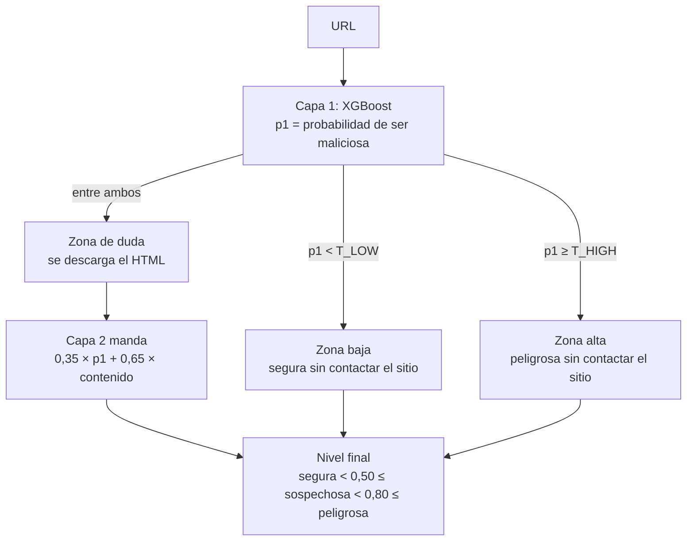

# PhishSentinel

Aplicación de escritorio para Windows que analiza enlaces y estima si son **seguros**, **sospechosos** o
**peligrosos**. Detecta señales de **phishing**, **malware** y **XSS** combinando dos capas:

- **Capa 1 – URL:** un modelo XGBoost que solo mira la dirección (63 características más un modelo de
  n-gramas de caracteres).
- **Capa 2 – Contenido:** reglas sobre el HTML estático de la página, que se descarga sin ejecutar JavaScript.

Es una herramienta de apoyo a la decisión, no un antivirus. Una URL "segura" no garantiza que el sitio sea
legítimo.

Proyecto de **Sistemas Inteligentes**, Universidad de Pamplona.
Equipo: Juan David Miranda Peláez, Marlon Arévalo, Miller Martínez y Juan Carlos Maestre Herrera.

## Contenido

- [Cómo decide](#cómo-decide)
- [Instalación y ejecución](#instalación-y-ejecución)
- [Uso de la aplicación](#uso-de-la-aplicación)
- [Estructura del proyecto](#estructura-del-proyecto)
- [Capa 1: el modelo](#capa-1-el-modelo)
- [Capa 2: reglas de contenido](#capa-2-reglas-de-contenido)
- [Datos](#datos)
- [Reentrenar y evaluar](#reentrenar-y-evaluar)
- [Resultados](#resultados)
- [Qué cambió en la v2](#qué-cambió-en-la-v2)
- [Limitaciones](#limitaciones)

## Cómo decide

La capa 1 calcula `p1`, la probabilidad de que la URL sea maliciosa, y la compara con dos umbrales que se
calibraron con datos de validación y vienen guardados dentro del modelo: **T_LOW = 0,0314** y
**T_HIGH = 0,8799**.



Reglas adicionales (`phishsentinel/engine.py`):

| Situación | Qué hace el motor |
|---|---|
| Zona de duda y contenido con riesgo ≥ 0,50 | El resultado nunca queda en "segura" (mínimo "sospechosa") |
| Zona de duda y contenido con riesgo ≥ 0,80 | "Peligrosa" |
| Parámetro de la URL reflejado en la página | XSS: puntaje mínimo de 0,85 |
| `<script>` o `onerror=` dentro de la URL | XSS: `p1` mínimo de 0,85 |
| Dominio del top 2.000 de Tranco o plataforma gratuita (`github.io`, `vercel.app`…) | La URL sola no basta para "peligrosa"; debe confirmarlo la capa 2 |
| Dominio con menos de 30 / 90 días (RDAP) | Suma +0,25 / +0,10, solo en la zona de duda o con análisis profundo; nunca baja el puntaje |
| **Análisis profundo** activado | Consulta la capa 2 también fuera de la zona de duda (solo puede subir el puntaje) |
| Dominio en la lista de excepciones | "Segura", salvo que la URL contenga código XSS |
| Puntaje "segura" entre 0,40 y 0,49 | Muestra el aviso "cercano al límite" |

## Instalación y ejecución

Requisitos: Windows con **Python 3.10 o posterior**. Internet solo hace falta para descargar páginas (capa 2) y
consultar la antigüedad del dominio.

```powershell
git clone https://github.com/Gal4h4d/PhishSentinel.git
cd PhishSentinel
python -m venv .venv
.venv\Scripts\activate
python -m pip install --upgrade pip
pip install -r requirements.txt
python main.py
```

El modelo `models/model_url.joblib` se carga automáticamente. Si no existe, la app usa reglas heurísticas de
respaldo.

**Prueba rápida sin interfaz:**

```powershell
python -m phishsentinel.cli https://www.unipamplona.edu.co/
python -m phishsentinel.cli <url> --deep       # consulta siempre la capa 2
python -m phishsentinel.cli <url> --no-fetch   # solo capa 1
```

**Crear el ejecutable** (con el entorno virtual activado):

```powershell
build_exe.bat
```

Genera `dist\PhishSentinel.exe`, que ya incluye el modelo, los íconos, `tldextract`, scikit-learn, XGBoost y
CustomTkinter. No necesita Python para ejecutarse.

## Uso de la aplicación

1. Pega una URL y pulsa **Analizar** (o Enter).
2. Revisa el nivel, el tipo de amenaza, el puntaje, el aporte de cada capa y los motivos.
3. **Análisis profundo:** consulta siempre la capa 2. Ten en cuenta que descargar la página revela tu IP al sitio.
4. **Vigilar portapapeles:** analiza cada enlace que copies y avisa si es riesgoso.
5. **Agregar a excepciones:** úsalo solo con dominios de confianza.
6. **Ver historial:** muestra los últimos análisis.

La descarga trae solo HTML estático, con un tiempo de espera de 5 s, un máximo de 1,5 MB y hasta
5 redirecciones.

El historial y las excepciones se guardan en `%APPDATA%\PhishSentinel\phishsentinel.db`, y los errores en
`%APPDATA%\PhishSentinel\phishsentinel.log`. La variable de entorno `PHISHSENTINEL_DATA` cambia esa carpeta.

## Estructura del proyecto

```text
.
├── main.py                      # Interfaz CustomTkinter (diseño de Figma)
├── phishsentinel/
│   ├── engine.py                # Zonas de la capa 1, combinación de capas y nivel final
│   ├── model.py                 # Clasificador: n-gramas (SGD) + 63 características → XGBoost
│   ├── features_url.py          # Normalización y 63 características de la URL (marcas, XSS, plataformas…)
│   ├── features_content.py      # Reglas de la capa 2 sobre el HTML
│   ├── fetcher.py               # Descarga de HTML estático
│   ├── domain_age.py            # Antigüedad del dominio (RDAP)
│   ├── popular_domains.py       # Top 2.000 de Tranco (reputación)
│   ├── brand_allowlist.py       # Dominios oficiales de cada marca
│   ├── storage.py               # Historial y excepciones (SQLite)
│   ├── cli.py                   # Prueba rápida por consola
│   └── config.py                # Umbrales, pesos y rutas
├── training/
│   ├── prepare_data.py          # Arma data/processed/urls.csv (4 clases, partición por dominio)
│   ├── train.py                 # Compara 5 algoritmos, entrena y calibra T_LOW / T_HIGH
│   ├── evaluate.py              # Evaluación final → models/evaluacion_final.md
│   ├── evaluate_future.py       # Phishing reciente, modelo anterior vs. nuevo
│   ├── collect_html.py          # Descarga HTML real para medir la capa 2
│   ├── feeds.py, synth.py, common.py
│   └── *_test.py                # Pruebas sobre conjuntos separados
├── tests/test_phishsentinel.py  # 36 pruebas automáticas (sin Internet)
├── models/                      # Modelo y resultados
├── data/
│   ├── raw/                     # Fuentes (ver "Datos")
│   ├── eval/                    # URLs y páginas de prueba escritas a mano
│   ├── processed/               # Lo genera prepare_data (no se sube)
│   └── html/                    # HTML descargado con collect_html (no se sube, ver "Datos")
├── assets/icons/                # Íconos Lucide (licencia ISC en la carpeta)
├── requirements.txt
└── build_exe.bat, PhishSentinel.spec
```

## Capa 1: el modelo

```text
URL ──┬─► 63 características numéricas ───────────────┐
      └─► n-gramas de caracteres (3-5) ► SGD ► 4 prob ─┴─► XGBoost ► P(legítima, phishing, malware, xss)
```

- **Normalización:** antes de medir, la URL se queda sin esquema, sin `www.` y sin la `/` final de un dominio
  solo. Las plataformas gratuitas se neutralizan (`usuario.github.io` se mide como `usuario.com`).
- **Características:** longitud, entropía, tokens, parámetros, IP, punycode, TLD, subdominios, palabras de
  phishing, extensiones, señales de XSS y suplantación de marca. La suplantación tiene tres tipos:
  - **contiene:** la marca aparece en un dominio ajeno (`nequi-premios`);
  - **disfraza:** la marca va escrita con números, símbolos o punycode (`bancol0mbia`);
  - **casi igual:** un nombre muy parecido a la marca (`instagran`).
- **Stacking:** las 4 probabilidades del modelo de texto entran al XGBoost como características extra. En el
  entrenamiento se calculan fuera de muestra y agrupadas por dominio.
- **Datos de entrenamiento:** 196.646 URLs de 4 clases. Ningún dominio aparece en dos particiones
  (entrenamiento, validación y prueba).
- **Formato:** XGBoost se guarda en su formato nativo dentro del `.joblib`, para que cargue igual en cualquier
  equipo.

## Capa 2: reglas de contenido

`features_content.py` suma pesos por evidencia. Una señal fuerte (≥ 0,5) basta para marcar; las débiles solo
cuentan juntas.

- Formulario de contraseña enviado a otro dominio registrado o a una IP.
- Marca en el título o logos de una marca que no coinciden con el dominio.
- Campos de tarjeta, CVV, PIN o cédula.
- Redirección `<meta refresh>` a otro dominio.
- Página casi vacía con formulario de acceso, o enlaces vacíos.
- Contraseña pedida sin HTTPS, o bloqueo del clic derecho en una página de acceso.
- Parámetros de la URL reflejados en la página (XSS).
- Ofuscación (`eval` combinado con `atob`/`unescape`) y enlaces a ejecutables.

Para evitar falsos positivos:

- Se ignoran los proveedores de inicio de sesión conocidos (Google, Microsoft, Apple, GitHub…) y los
  `<iframe>` de analítica.
- Los scripts externos o un `eval` sueltos no cuentan.

## Datos

Todos los archivos están en `data/raw/`:

| Archivo | Contenido |
|---|---|
| `URL dataset.csv` | Dataset de URLs legítimas y de phishing (`url`, `type`) |
| `malicious_phish.csv` | Dataset de URLs benignas, phishing y malware (`url`, `type`) |
| `tranco.csv` | Lista Tranco de dominios populares (rango, dominio; sin encabezado) |
| `phishtank.csv` | PhishTank `verified_online.csv` |
| `openphish.txt` | OpenPhish `feed.txt` |
| `urlhaus.csv` | URLhaus `recent` |
| `*xss*.txt`, `XSS_dataset.csv`, etc. | Payloads de XSS |

Cómo se usan los feeds actuales:

- **PhishTank:** las URLs de 2021 al 31-ago-2026 entran al entrenamiento (12.436, con un tope de 5 por plantilla
  de campaña). Desde el 1-sep-2026 PhishTank y todo OpenPhish quedan **solo para prueba**, como "el futuro".
- **URLhaus:** se descartan los enlaces de GitHub y otros hosts compartidos (eran el 85 %), para que el modelo no
  aprenda que "GitHub + .zip = malware". Entran 2.506 URLs.
- **Tranco:** los rangos 15.001–20.000 (validación) y 20.001–30.000 (prueba final) nunca se usan para entrenar.

El 20-nov-2026 se descargaron con `training.collect_html` unas 1.780 páginas legítimas y 2.800 de phishing
(`data/html/`, con su `manifest.csv`). Por tamaño (unos 630 MB) no están en el repositorio: se comparten
aparte, y se pueden volver a descargar con el mismo comando. Todavía no se han usado para medir ni entrenar la
capa 2. **No abras esos archivos en el navegador.**

## Reentrenar y evaluar

```powershell
python -m training.prepare_data       # data/processed/urls.csv
python -m training.train              # compara 5 algoritmos, entrena y calibra umbrales (~15 min)
python -m training.evaluate           # → models/evaluacion_final.md y .json
python -m training.evaluate_future    # → models/evaluacion_futuro.csv
python -m unittest discover -s tests -v
```

Opciones de `train.py`:

- `--compare-rows 8000`: compara los algoritmos más rápido.
- `--mode binary`: entrena un modelo binario.
- `--clean`: quita las etiquetas dudosas del entrenamiento.
- `--tune`: busca hiperparámetros de XGBoost.

Otras pruebas, en `training/`:

| Comando | Qué mide | Internet |
|---|---|---|
| `scheme_bias_test` | Mismo resultado con `http://` y `https://www.` | No |
| `long_url_fp_test` | Falsos positivos en URLs largas legítimas | No |
| `tranco_fp_test` | Falsos positivos en dominios populares | No |
| `phishing_recall_test` | Phishing no visto que se escapa | No |
| `platform_probe_test` | 25 sitios legítimos en plataformas gratuitas | No |
| `layer2_cases_test` | 8 páginas HTML de ejemplo (`data/eval/html/`) | No |
| `cross_source_test` | Generalización entre fuentes de datos | No |
| `collect_html` | Descarga HTML para la capa 2 (usar en VM o con VPN) | Sí |
| `tranco_layer2_test --n 500` | Falsos positivos de la capa 2 en sitios reales | Sí |

Úsalos como `python -m training.<comando>`, después de correr `training.prepare_data`.

## Resultados

Todas las cifras son de datos que el modelo no vio. El detalle está en `models/evaluacion_final.md` y
`models/evaluacion_futuro.csv`.

### Partición de prueba (dominios no vistos, 27.076 URLs)

**F1 macro 0,887** (antes se reportaba 0,985, pero esa cifra estaba inflada por dominios repetidos y atajos del
dataset).

| Clase | Precisión | Recall | F1 |
|---|---|---|---|
| Legítima | 0,802 | 0,904 | 0,850 |
| Malware | 0,962 | 0,812 | 0,880 |
| Phishing | 0,858 | 0,788 | 0,821 |
| XSS | 0,995 | 0,995 | 0,995 |

### Phishing reciente: modelo anterior vs. nuevo (mismas URLs)

Datos de PhishTank desde el 1-sep-2026 y OpenPhish, de hosts no vistos.

| Conjunto | n | Bloqueo directo | Se escapa sin capa 2 | Marcada (p ≥ 0,5) |
|---|---|---|---|---|
| PhishTank reciente | 1.275 | 25 % → **56 %** | 3,4 % → 0,3 % | 74 % → 85 % |
| · con HTTPS | 1.088 | 24 % → 51 % | 3,8 % → 0,3 % | 72 % → 83 % |
| · en plataforma gratuita | 202 | 15 % → 54 % | 4,0 % → 0,5 % | 54 % → 82 % |
| OpenPhish | 166 | 7 % → 47 % | 4,8 % → 0,6 % | 63 % → 78 % |
| URLhaus malware (sin GitHub) | 731 | 78 % → 88 % | 0,4 % → 0,1 % | 94 % → 97 % |

### Falsos positivos y recall

| Prueba | Resultado |
|---|---|
| Tranco 20.001–30.000 (10.000 dominios raíz) | 0,02 % bloqueo directo · 0,7 % marcadas con 0,5 · 53 % pasan a capa 2 |
| Legítimas largas reales (≥ 100 caracteres, 3.138) | 0,7 % bloqueo directo · 2,1 % marcadas con 0,5 |
| Legítimas cortas con ruta (7.008, el caso más difícil) | 3,1 % bloqueo directo · 13 % marcadas con 0,5 |
| Phishing no visto que se escapa sin capa 2 | 1,1 % con ruta · 5,2 % solo dominio |
| Malware / XSS: bloqueo directo | 87 % / 99,3 % |
| 25 sitios legítimos en plataformas gratuitas | 16 % bloqueo directo · 56 % marcadas con 0,5 |
| 54 URLs largas de servicios grandes escritas a mano (solo capa 1) | 31 % no seguras (antes 20 %) |
| Capa 2 sobre 8 páginas de ejemplo | 7 de 8 con el nivel esperado* |

\* El caso que falla es una IP con ruta de PayPal: la capa 1 la bloquea por la URL antes de mirar el contenido.

### Comparación de algoritmos (validación, muestra de 20.000 URLs)

| Modelo | F1 validación cruzada | F1 | Falsos positivos |
|---|---|---|---|
| XGBoost | 0,918 | 0,880 | 13,9 % |
| Random Forest | 0,914 | 0,883 | 14,1 % |
| SVM | 0,899 | 0,873 | 13,0 % |
| Regresión logística | 0,888 | 0,875 | 11,9 % |
| KNN | 0,887 | 0,841 | 13,9 % |

Se eligió XGBoost: con todo el entrenamiento supera a Random Forest (F1 0,884 frente a 0,877, con 8,4 % de
falsos positivos frente a 8,6 %; ver `models/resultados_completo.csv`). Esta tabla
se generó antes de quitar la barra final del dominio, así que conviene regenerarla con `training.train`.

### Intentos que no mejoraron la métrica

- **Limpieza de etiquetas** (`--clean`): solo 823 de 203.446 filas (0,4 %) eran dudosas, y quitarlas no cambió
  nada.
- **Ajuste de hiperparámetros** (`--tune`, 5 configuraciones, `models/ajuste_hiperparametros.csv`): el F1 quedó
  entre 0,888 y 0,890. El límite lo pone la información que hay en la URL, no el algoritmo.
- **Antigüedad del dominio:** está programada, pero no se pudo medir, porque los dominios de los datasets
  antiguos ya no existen.

## Qué cambió en la v2

1. **Se quitaron los atajos del dataset.** El 100 % de las legítimas empezaba por `https://www.` y el 94 % del
   phishing por `http://`. Ahora se normaliza la URL, y `scheme_bias_test` confirma que el resultado es idéntico
   con o sin ellos.
2. **Evaluación honesta por dominio:** ningún dominio aparece a la vez en entrenamiento y prueba.
3. **63 características y un modelo de n-gramas en stacking**, con detección de marcas disfrazadas
   (`bancol0mbia`, `instagran`, `nequi-premios`).
4. **4 clases** (legítima, phishing, malware y XSS). `defacement` se descartó: son sitios legítimos hackeados,
   iguales a los benignos en la URL.
5. **URLs largas legítimas:** 14.000 reales y 20.000 sintéticas (con IDs opacos como `/d/1AbC…/edit`).
6. **Zona de duda calibrada:** en ella manda la capa 2 (65 %).
7. **Reputación:** los dominios populares y las plataformas gratuitas no se bloquean solo por la URL.
8. **Capa 2 corregida:**
   - compara el dominio registrado en vez del hostname;
   - ignora los `<iframe>` de analítica;
   - agrega señales nuevas de phishing.
9. **Antigüedad del dominio** consultada por RDAP.
10. **Interfaz CustomTkinter** basada en el diseño de Figma, con análisis profundo, historial y alerta del
    portapapeles.
11. **Feeds actuales** de PhishTank, OpenPhish y URLhaus, con datos de "el futuro" reservados para la prueba.

## Limitaciones

- Con solo la URL es difícil separar legítima de phishing (F1 de phishing 0,82); por eso existe la zona de duda.
- **La capa 2 no se ha medido con páginas reales.** Ya está el HTML descargado en `data/html/`; falta evaluarla
  con él o con `tranco_layer2_test` (con Internet).
- Las URLs de XSS y las URLs largas sintéticas son plantillas, no tráfico real, así que sus métricas son
  optimistas.
- Las 54 URLs escritas a mano se usaron mientras se diseñaban los patrones sintéticos: son un indicio, no una
  métrica independiente.
- Entrenar con phishing moderno hizo al modelo más desconfiado con URLs largas de servicios grandes (de 20 % a
  31 % en esas 54 URLs, sin descargar la página). En la app, la zona de duda lo resuelve con la capa 2.
- Faltan sitios legítimos alojados en plataformas gratuitas para medir bien ese sesgo.
- El umbral bajo deja pasar cerca del 1,5 % de las amenazas de validación sin consultar la capa 2.
- La capa 2 no ejecuta JavaScript: en páginas que se construyen en el navegador puede no ver el contenido final.
- Los feeds envejecen: conviene reentrenar periódicamente (`prepare_data` y luego `train`).
- Descargar una página revela tu IP al sitio. Usa una máquina virtual o una VPN para recolectar phishing.

## Licencia

Los íconos son de [Lucide](https://lucide.dev) (licencia ISC, ver `assets/icons/LICENSE-lucide.txt`). El
proyecto no incluye todavía una licencia propia: consulta al equipo antes de redistribuirlo.
