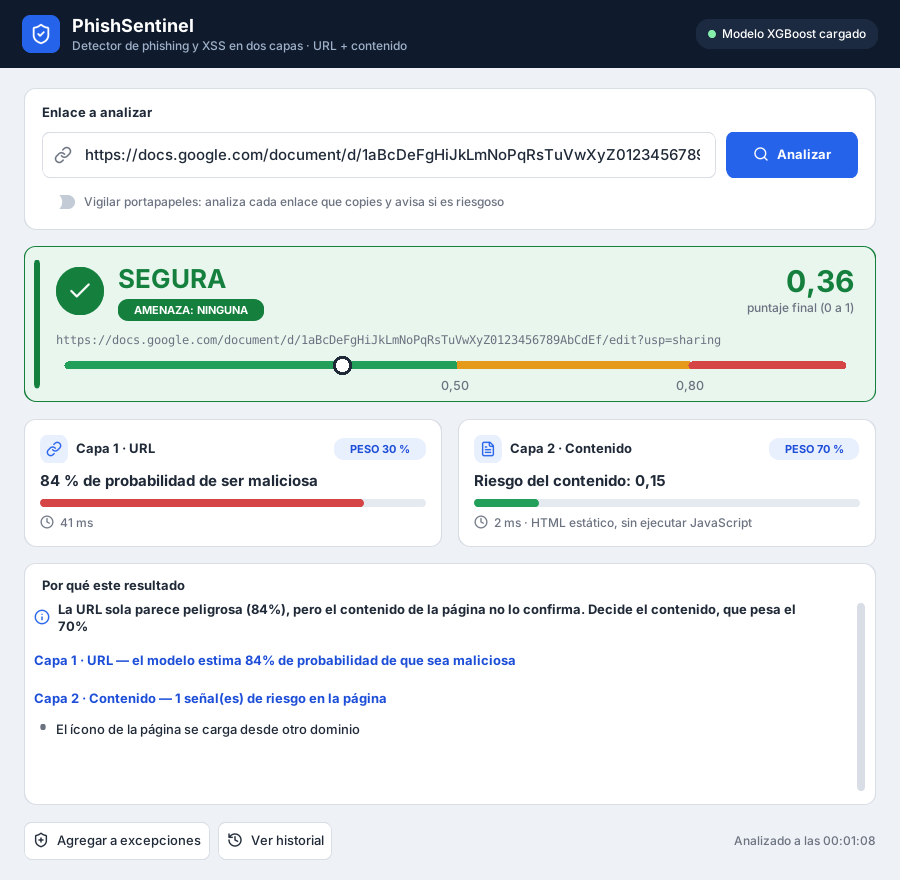
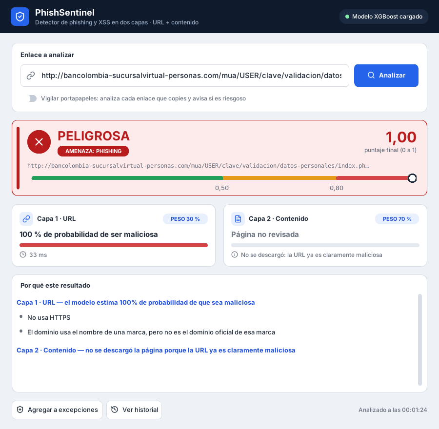
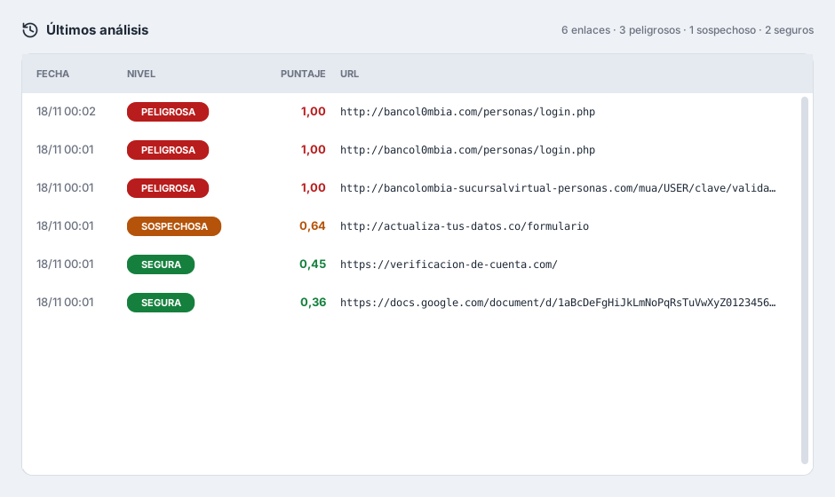
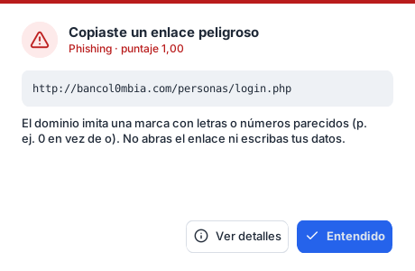

# PhishSentinel

PhishSentinel es una aplicación de escritorio para Windows que analiza URLs y
ayuda a identificar señales de phishing y Cross-Site Scripting (XSS). Combina
un modelo de aprendizaje automático para la URL con reglas de análisis del
contenido HTML.

El proyecto está pensado como una herramienta de detección y apoyo al análisis,
no como un reemplazo de un navegador seguro, un antivirus o una revisión
manual.

## Funcionalidades

- Análisis manual de una URL desde una interfaz de escritorio (CustomTkinter),
  diseñada en Figma: tarjeta de resultado por nivel, barra de puntaje, una
  tarjeta por capa, motivos agrupados, historial en tabla y alerta del
  portapapeles.
- Vigilancia opcional del portapapeles para analizar los enlaces que se copian.
- Clasificación en tres niveles: `segura`, `sospechosa` y `peligrosa`.
- Identificación de amenazas como `phishing` y `xss`.
- Análisis en dos capas:
  - **Capa 1 (URL, modelo ML):** 40 características léxicas, de dominio y de
    XSS calculadas sobre la URL canónica (sin `http(s)://`, `www.` ni `/` final).
    Incluye la detección de marcas usadas en un dominio que no es el oficial
    (`nequi-premios.com`), disfrazadas (`bancol0mbia.com`, punycode) o escritas
    casi igual (`instagran.com`).
  - **Capa 2 (contenido HTML, reglas):** formularios de contraseña que envían a
    otro dominio, suplantación de marca, campos de datos sensibles, acciones de
    formulario sospechosas, redirecciones automáticas, iframes ocultos,
    JavaScript riesgoso, favicon externo, enlaces vacíos o externos, bloqueo del
    clic derecho y parámetros reflejados (XSS).
  - **La capa 2 tiene prioridad:** con HTML disponible el puntaje es
    `0.3 × capa 1 + 0.7 × capa 2`. Una página limpia puede bajar el puntaje de
    una URL que solo "se ve rara"; la capa 1 sola solo puede dejar la URL como
    `sospechosa`, y únicamente si el modelo está casi seguro (≥ 0,95). Los pesos
    están en `phishsentinel/config.py`.
- Los motivos dicen qué encontró cada capa ("Capa 1 (URL)…", "Capa 2
  (contenido)…") y, cuando el contenido cambia el nivel, por qué decide.
- Niveles por puntaje: `segura` < 0,50 ≤ `sospechosa` < 0,80 ≤ `peligrosa`. Entre
  0,40 y 0,49 la URL sigue siendo `segura` (sin alerta emergente), pero se muestra
  el aviso "Puntaje cercano al límite: revisa el enlace antes de ingresar datos".
- Registro local del historial de detecciones mediante SQLite.
- Lista de excepciones por dominio.
- Funcionamiento con reglas heurísticas cuando no hay un modelo entrenado.
- Creación de un ejecutable independiente mediante PyInstaller.

## Capturas

| Segura: decide la capa 2 | Peligrosa |
| --- | --- |
|  |  |

| Historial | Alerta del portapapeles |
| --- | --- |
|  |  |

El diseño de la interfaz (variables de color, estilos de texto, componentes y
pantallas por estado) está en Figma:
[PhishSentinel – Diseño de interfaz](https://www.figma.com/design/8agO2X8dIDqx5pcvofN8ha).

Las cifras de las correcciones (antes y después, comparación de algoritmos y
elección del umbral) están en [docs/RESULTADOS.md](docs/RESULTADOS.md).

## Requisitos

- Python 3.10 o posterior.
- Tkinter, incluido normalmente en Windows (en Linux, el paquete del sistema
  `python3-tk`). La interfaz usa CustomTkinter y Pillow, que se instalan con
  `requirements.txt`.
- Conexión a Internet únicamente cuando se analiza el contenido de una URL.

## Instalación y ejecución

En Windows:

```powershell
git clone https://github.com/Gal4h4d/PhishSentinel.git
cd PhishSentinel
python -m venv .venv
.venv\Scripts\activate
python -m pip install --upgrade pip
pip install -r requirements.txt
python main.py
```

La aplicación carga automáticamente `models/model_url.joblib` si el archivo
existe. Si no está disponible, utiliza las reglas heurísticas definidas en
`phishsentinel/engine.py`.

## Uso

1. Introduce una URL que comience por `http://`, `https://` o `www.`.
2. Pulsa **Analizar** o presiona Enter.
3. Revisa el nivel, la amenaza, el puntaje, los tiempos de cada capa y los
   motivos detectados.
4. Activa **Vigilar portapapeles** si quieres analizar automáticamente cada
   enlace que copies.
5. Usa **Agregar dominio a excepciones** solo para dominios de confianza.
6. Consulta **Ver historial** para revisar las detecciones guardadas.

El descargador obtiene únicamente HTML estático: no ejecuta JavaScript. Las
solicitudes tienen un tiempo de espera de cinco segundos y el contenido está
limitado a 1,5 MB. Si la descarga falla, la evaluación de la URL puede
continuar con la primera capa.

## Modelos y datos

El repositorio incluye modelos y resultados generados en `models/`. La
aplicación utiliza automáticamente `model_url.joblib`; los demás archivos
sirven como resultados o artefactos de experimentación.

Los conjuntos de datos usados están en `data/raw/` con estos nombres y columnas:

| Archivo | Columnas principales | Uso |
| --- | --- | --- |
| `URL dataset.csv` | `url`, `type` | URLs legítimas y de phishing |
| `tranco.csv` | rango, dominio | Dominios legítimos adicionales |
| `xss_*.csv` | `Sentence`, `Label` | Payloads XSS |
| `xss_*.txt` | un payload por línea | Payloads XSS adicionales |

`training/prepare_data.py` también puede generar ejemplos XSS a partir de
payloads y ejemplos legítimos con parámetros normales. Revisa las fuentes
configuradas en `SOURCES` antes de preparar los datos.

## Entrenamiento

```powershell
python -m training.prepare_data
# Comparación de los 5 algoritmos (20.000 URLs: SVM y KNN son lentos con más datos)
python -m training.train --mode multiclass --max-rows 20000
# Modelo que usa la app: XGBoost con todo el conjunto
python -m training.train --mode multiclass --max-rows 150000 --models XGBoost,LogReg
```

`prepare_data` asegura URLs largas en las clases legítima y de phishing (unas
11.000 de 100+ caracteres en cada una) e incluye 8.000 URLs legítimas largas
generadas sobre dominios de Tranco, con rutas, IDs aleatorios y parámetros de
seguimiento u OAuth, como las reales.

También agrega 1.200 URLs legítimas de ruta corta (`tiktok.com/es/`,
`ejemplo.com/help`), que casi no existían en la clase legítima: sin ellas el
modelo marcaba como phishing cualquier dominio con una ruta corta.

La lista de dominios propios de las marcas (`googleapis.com`,
`amazonvideo.com`…) se genera con `python -m training.build_brand_allowlist`
a partir del top 20.000 de Tranco; el rango 20.000–30.000 queda para pruebas.

`train` elige el mejor modelo por validación cruzada (`cv_f1`), no con el
conjunto de prueba. Guarda `models/model_<modo>.joblib` y
`models/resultados_<modo>.csv`; en modo multiclase también actualiza
`model_url.joblib` y `resultados.csv`, que son los que usa la app. El Random
Forest con todo el conjunto pesa más de 300 MB, por eso la app usa XGBoost.

## Pruebas

| Comando | Qué mide |
| --- | --- |
| `python -m training.long_url_fp_test` | Falsos positivos en URLs legítimas largas (`data/eval/urls_largas_legitimas.txt` y URLs no vistas del dataset) y, como control, recall en phishing largo |
| `python -m training.scheme_bias_test` | Si cambiar solo `http`/`https`/`www` cambia la respuesta del modelo (no debería) |
| `python -m training.tranco_fp_test` | Falsos positivos en 10.000 dominios populares (Tranco) |
| `python -m training.phishing_recall_test` | Recall en URLs de phishing no usadas al entrenar |
| `python -m training.layer2_cases_test` | Capa 2 sin internet, con páginas de ejemplo en `data/eval/html/` |
| `python -m training.tranco_layer2_test` | Capa 1 sola contra capa 1 + capa 2 en sitios reales (necesita internet) |
| `python -m training.cross_source_test` | Generalización de XSS entre fuentes de payloads |

## Crear el ejecutable

En Windows, con el entorno virtual activado:

```powershell
build_exe.bat
```

El ejecutable se genera en `dist/PhishSentinel.exe`. El script incluye los
modelos y los recursos necesarios de `tldextract`, scikit-learn y XGBoost.

## Estructura del proyecto

```text
.
├── main.py                       # Interfaz gráfica (CustomTkinter)
├── assets/icons/                 # Íconos Lucide (PNG, licencia ISC)
├── phishsentinel/
│   ├── engine.py                 # Decisión y combinación de las capas
│   ├── features_url.py           # Características de URL y señales XSS
│   ├── features_content.py       # Reglas de análisis HTML
│   ├── fetcher.py                # Descarga de HTML estático
│   ├── storage.py                # Historial y excepciones en SQLite
│   └── config.py                 # Umbrales y rutas de ejecución
├── training/
│   ├── prepare_data.py           # Preparación de los datasets
│   ├── train.py                  # Comparación y entrenamiento de modelos
│   └── *_test.py                 # Pruebas sobre conjuntos separados
├── models/                       # Modelos y resultados incluidos
├── data/eval/                    # Conjuntos de prueba (URLs largas, páginas HTML de ejemplo)
├── docs/                         # Resultados de las correcciones y capturas
├── requirements.txt
└── build_exe.bat
```

La base de datos local se guarda en:

```text
%APPDATA%\PhishSentinel\phishsentinel.db
```

## Limitaciones conocidas

- El análisis de contenido solo considera el HTML recibido inicialmente y no
  renderiza páginas ni ejecuta JavaScript.
- Una URL clasificada como segura no garantiza que el sitio sea legítimo.
- La disponibilidad, redirecciones y respuesta del sitio remoto pueden
  afectar al análisis de la segunda capa.
- Los modelos dependen de la calidad y representatividad de los datasets
  utilizados para entrenarlos.

## Licencia

Este repositorio no incluye actualmente un archivo de licencia. Consulta al
autor antes de redistribuir o incorporar el proyecto en otro producto.
